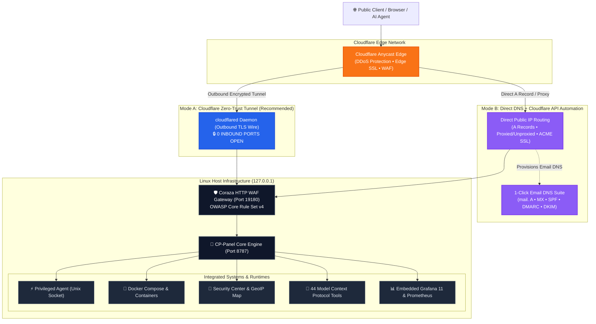

<div align="center">

# 🛡️ CP-Panel · by CyberPross
### The Enterprise Zero-Trust Linux Server Management & Autonomous AI Control Plane

[](https://github.com/nitishk1-hub/CP-Panel/releases)
[](tests/)
[](LICENSE)
[](https://nodejs.org)
[](docs/INSTALLATION.md)
[](docs/WAF-AND-VAULT.md)
[](docs/PANEL-ACCESS.md)
[](docs/AI-CONNECTIONS.md)
[](docs/GRAFANA-PANEL-ARCHITECTURE.md)

<p align="center">
  <b>CP-Panel</b> is a next-generation, high-performance, open-source Linux server control plane developed by <b>CyberPross</b>.<br>
  Built from the ground up for <b>Zero-Trust Privacy (0 Open Inbound Ports)</b>, <b>Inline Coraza WAF Defense (OWASP CRS v4)</b>, <b>Dynamic Cloudflare DNS &amp; 1-Click Email Provisioning</b>, <b>Isolated Docker Orchestration</b>, and <b>Autonomous AI DevOps via Model Context Protocol (MCP)</b>.
</p>

[Quick Start](#-quick-start--os-implementation-guide) • [Why CP-Panel?](#-why-cp-panel) • [OS Implementation Guide](#-os-implementation-guide) • [Dual Ingress Modes](#-dual-network-ingress-architecture) • [Core Features](#-core-features--capabilities) • [54 MCP Tools](#-the-54-production-mcp-tools) • [AI Client Integration](#-connecting-external-ai-clients-to-cp-panel) • [Documentation](#-documentation) • [FAQ](#-frequently-asked-questions-faq) • [License](#-license)

</div>

---

## 🌟 Why CP-Panel?

Traditional web hosting control panels (such as **cPanel**, **Plesk**, **1Panel**, **aaPanel**, or **CyberPanel**) mandate opening and exposing raw management ports (`2083`, `8888`, `8090`) and raw web ports (`80`, `443`) directly to the public internet. This leaves servers exposed to automated botnets, credential brute-forcing, zero-day unauthenticated RCE exploits, and volumetric DDoS attacks.

**CP-Panel** redefines server administration around an enterprise-grade, battle-tested zero-trust architecture:

| Feature / Dimension | Traditional Panels (cPanel / 1Panel / aaPanel) | CP-Panel (CyberPross) |
| :--- | :--- | :--- |
| **Inbound Attack Surface** | Exposes 80, 443, 2083, 8888, 21, 22 directly | **0 Inbound Ports Open** (Strict loopback isolation via Cloudflare Tunnel) |
| **Direct DNS Option** | Manual A record and DNS record configuration | **Automated Cloudflare API Suite** with Dynamic IP sync and Orange Cloud toggle |
| **Email DNS Provisioning** | Manual, error-prone MX, SPF, DMARC, DKIM records | **1-Click Full Email DNS Suite** (Automates `mail.`, MX, SPF, DMARC, DKIM) |
| **Web Application Firewall** | Basic ModSecurity or expensive commercial add-ons | **Native Coraza HTTP WAF** with OWASP Core Rule Set (CRS v4) built-in |
| **Threat Mesh &amp; Reputation**| Local-only Fail2ban with zero global context | **CrowdSec LAPI** distributed community threat intelligence mesh |
| **AI DevOps &amp; Copilots** | None, or basic text generation prompts | **54 Production MCP Tools** with OAuth 2.0 PKCE &amp; Streamable HTTP |
| **Runtime Isolation** | Shared host root/user processes | **Containerized Sandbox Runtimes** (`node:24-bookworm-slim`, PHP, Python) |
| **Incident Notifications** | Simple plain-text emails | **Multi-Channel Dispatcher** (Telegram, Discord, Slack, HMAC Webhooks) |
| **Observability &amp; Telemetry** | Rudimentary charts or paid third-party add-ons | **Embedded Grafana 11 &amp; Prometheus** with low-overhead sampling |
| **Licensing &amp; Privacy** | Expensive recurring per-account or per-core fees | **100% Free &amp; Open-Source (Apache-2.0)** with zero tracking telemetry |

---

## 🚀 Quick Start & OS Implementation Guide

CP-Panel is engineered and verified for modern, systemd-based Linux distributions on `x86_64` (AMD64) and `aarch64` (ARM64) architectures.

### 📋 Supported Operating Systems Matrix

| Operating System | Version | Support Tier | Package System | Tested Kernel |
| :--- | :--- | :--- | :--- | :--- |
| **Ubuntu Server** | **24.04 LTS (Noble Numbat)** | **Tier 1 (Recommended)** | APT / systemd | Linux 6.8+ |
| **Ubuntu Server** | **22.04 LTS (Jammy Jellyfish)** | **Tier 1** | APT / systemd | Linux 5.15+ |
| **Debian GNU/Linux** | **12 (Bookworm)** | **Tier 1** | APT / systemd | Linux 6.1+ |
| **Debian GNU/Linux** | **13 (Trixie)** | **Tier 2 (Candidate)** | APT / systemd | Linux 6.6+ |

---

### 💻 Step-by-Step OS Implementation

#### Step 1: Prepare the Host System

Before installing, ensure your package lists are updated and essential system utilities are present.

**On Ubuntu (24.04 / 22.04 LTS):**
```bash
sudo apt update && sudo apt upgrade -y
sudo apt install -y curl ufw systemd ca-certificates git
```

**On Debian (12 / 13):**
```bash
sudo apt update && sudo apt upgrade -y
sudo apt install -y curl ufw systemd ca-certificates git sudo
```

> [!TIP]
> **Firewall Recommendation:** If you plan to use **Mode A (Cloudflare Tunnel)**, you do not need to open any inbound ports on UFW! Keep UFW default deny:
> ```bash
> sudo ufw default deny incoming
> sudo ufw default allow outgoing
> sudo ufw allow ssh  # Keep your SSH access open
> sudo ufw enable
> ```

---

#### Step 2: Run the 1-Line Universal Installer

Execute the official CyberPross installation script with administrative privileges:

```bash
curl -fsSL https://raw.githubusercontent.com/nitishk1-hub/CP-Panel/main/install.sh | sudo bash
```

**What the installer performs automatically:**
1. **Prerequisite Check**: Validates kernel, architecture (`x86_64` / `arm64`), systemd, and memory ($\ge 1\text{ GB}$).
2. **Runtime Setup**: Installs Node.js v24 LTS control runtime if absent.
3. **Sandbox Pre-Caching**: Pulls and caches isolated application runtime images (`node:24-bookworm-slim`).
4. **Cryptographic Release Verification**: Downloads release assets and verifies **Ed25519 digital signatures**.
5. **Systemd Daemon Configuration**: Installs and enables `server-panel.service` and `server-panel-agent.service`.
6. **Credential Generation**: Configures the initial admin account and writes a single-use emergency recovery token to `/etc/server-panel/recovery/` with strict `0700` permissions.

---

#### Step 3: Accessing the Control Plane

Once the installer completes, the panel listens securely on private loopback (`127.0.0.1:8787`).

##### Local or SSH Port-Forwarded Access:
If accessing from a remote workstation via SSH:
```bash
ssh -N -L 8787:127.0.0.1:8787 user@your-server-ip
```
Then navigate to: 👉 **`http://127.0.0.1:8787`** in your browser.

> [!IMPORTANT]
> At initial sign-in, provide the generated credentials from the installer. You will be prompted to enroll in Multi-Factor Authentication (MFA / TOTP) to lock down administrative access.

---

### 🛠️ Alternative: Manual Developer Build from Source

For developers, contributors, or air-gapped deployments:

```bash
# 1. Clone the repository
git clone https://github.com/nitishk1-hub/CP-Panel.git
cd CP-Panel

# 2. Install dependencies & compile frontend bundles
npm ci
npm run build:tools

# 3. Execute the full test suite (all 240 tests must pass)
npm test

# 4. Initialize administrative identity
npm run first-run

# 5. Start the production panel daemon
npm start
```

---

## 🔒 Dual Network Ingress Architecture

CP-Panel offers two distinct network routing topologies. You can configure or switch between them dynamically in **System → Cloudflare Tunnel & DNS**:



### 1. Mode A: Cloudflare Zero-Trust Tunnel (Default · 0 Inbound Open Ports)
* **Zero Public Attack Surface**: The server firewall completely blocks all inbound web ports (`80`, `443`, `8787`).
* **Outbound Encrypted Wire**: The `cloudflared` daemon creates redundant outbound TLS tunnels to Cloudflare Edge.
* **Automated Edge SSL**: Public HTTPS is terminated automatically by Cloudflare with universal TLS 1.3 certificates, eliminating origin certificate management headaches.

### 2. Mode B: Direct DNS with Cloudflare API Automation
If your architecture requires direct server IP connections rather than tunneling:
* **Dynamic A-Record Provisioning**: Detects your server's public IPv4/IPv6 automatically and creates or updates root and subdomain `A` records with configurable Orange Cloud proxying (`proxied: true` or `proxied: false`).
* **1-Click Full Email DNS Suite**:
  * **Mail Host (`A`)**: `mail.<your-domain>` pointing directly to your host (`proxied: false`, mandatory for mail).
  * **Mail Exchanger (`MX`)**: Priority 10 pointing to `mail.<your-domain>`.
  * **SPF (`TXT`)**: `v=spf1 mx a ip4:<server_ip> ~all` authorizing your IP for outbound mail delivery.
  * **DMARC (`TXT`)**: `_dmarc.<your-domain>` with configurable `p=quarantine` or `p=reject` policies.
  * **DKIM (`TXT`)**: Selector placeholder for cryptographic email header signing.
* **Automated ACME DNS-01 SSL Certificates**: Automatically provisions Let's Encrypt / ZeroSSL certificates using Cloudflare DNS-01 API challenges with automated renewal.

---

## ⚡ Core Features & Capabilities

### 🛡️ 1. Enterprise Security Center & Threat Defense
* **Sidebar Sub-Menus**: Dedicated sub-navigation for **Threat Map**, **Access Control**, **Domain WAF**, and **Security Engines**.
* **Coraza HTTP WAF**: Native Go/CGo-free Web Application Firewall inspecting HTTP traffic against OWASP CRS v4 signatures to neutralize SQLi, XSS, RCE, LFI, and SSRF attacks.
* **CrowdSec LAPI Mesh**: Integrated bouncer (`panel-coraza-bouncer`) pulling community threat decisions and blocking malicious IP addresses at the gateway.
* **Interactive 3D Threat Map**: WebGL vector map clustering mitigated threats in real time with ASN, country, and city geolocation intelligence.
* **Live SSE Telemetry Stream**: Real-time event streaming (`/api/security-center/stream`) and automatic 12-second polling to update KPI cards without screen flicker.

### 🤖 2. Autonomous AI DevOps & Model Context Protocol (MCP)
* **54 Production-Ready MCP Tools**: Granular tools allowing AI agents (ChatGPT, Claude Code, Cursor, Windsurf, Antigravity) to inspect, manage, build, test, and repair servers without raw root shell exposure.
* **OAuth 2.0 with PKCE**: Strict cryptographic authentication enforcing token rotation, short-lived bearer tokens, and intent validation (`read`, `manage`, `command`).
* **Transactional File Safety**: File edits through `panel_file_edit` validate syntax before committing, create atomic backups, and automatically roll back on failure.
* **Graphify Knowledge Graph**: Semantic AST code graph indexing that slashes LLM context token consumption by **35x–77x**.

### 📢 3. Incident Notification Command Center
* **Unified Dispatching**: Native webhook dispatchers for **Telegram**, **Discord**, **Slack**, and **Custom HTTPS Endpoints**.
* **Cryptographic HMAC Signatures**: Payloads are signed with `X-Panel-Signature-256` HMAC-SHA256 headers for zero-trust receiver verification.
* **Granular Severity Routing**: Filter alerts across 🔴 **CRITICAL**, 🟡 **WARNING**, and 🔵 **INFO** tiers.
* **Live Previews**: Visual rendering engine showing exactly how formatted cards render in Telegram MarkdownV2 and Discord Rich Embeds.

### 🐳 4. Docker Workspace & 1-Click App Store
* **Visual Compose Studio**: Multi-file Docker Compose workspace with syntax linting, environment variable interpolation, and drift detection.
* **Curated 1-Click Store**: Instant deployments for PostgreSQL, MySQL, Redis, SearXNG, n8n, Jellyfin, Nextcloud, WordPress, and more.
* **Image Management**: Integrated cleanup tools, multi-registry authentication (Docker Hub, GHCR, AWS ECR), and build utilities.

### 🌐 5. Native Web Engine & Sandbox Hosting
* **Multi-Language Hosting**: Host Node.js, Python WSGI/ASGI, PHP-FPM, and static applications.
* **Host vs. Sandbox Runtime Separation**: The panel runs securely on host Node.js v24 LTS while user applications run in isolated container sandboxes (`node:24-bookworm-slim`), completely isolating customer code from host files.

### 📊 6. Embedded Observability & Autonomous Self-Healing
* **Grafana 11 & Prometheus**: Embedded dashboards (`CyberPross Server Overview` and `Security Center`) pre-configured out of the box.
* **Autonomous Health Supervisor**: Continuously monitors systemd units, containers, inodes, and endpoints with automated recovery policies and cooldown protection.

---

## 🛠️ The 54 Production MCP Tools

CP-Panel provides **54 purpose-built Model Context Protocol (MCP) tools** divided into 8 functional domains:

| Domain | Tools | Scope | Confirmation | Description |
| :--- | :--- | :---: | :---: | :--- |
| **Unified Deployment & Projects** | `panel_deploy`, `panel_project_edit`, `panel_project_read`, `panel_app_inventory` | `read` / `manage` | Deployments & edits | Unified Deployment Controller (Preview → Build → Test → Deploy → Verify → Rollback), multi-file transactional project editing, and end-to-end domain-to-container inventory. |
| **System & Daemon Control** | `panel_systemd`, `panel_nginx`, `panel_docker`, `panel_compose`, `panel_cloudflare`, `panel_coraza`, `panel_crowdsec` | `manage` | Yes | Supervised lifecycle control for systemd units, Nginx virtual hosts, Docker containers, Compose stacks, Cloudflare Tunnel, and Coraza WAF. |
| **Developer & Sysadmin Tools** | `panel_apt`, `panel_git`, `panel_docker_build`, `panel_test_runner`, `panel_cloudflare_dns` | `command` / `manage` | Mutating actions | Structured APT change-impact previews (dependency, removal & reboot reporting), Git auto-discovery & workspace selection, BuildKit-isolated Docker image building, and sandboxed test execution. |
| **Security & Threat Audit** | `panel_security_inspect`, `panel_network_inspect`, `panel_docker_security_inspect`, `panel_security_scan`, `panel_waf_verify`, `panel_waf_exempt` | `read` / `manage` | Exemptions only | Comprehensive audits: Docker privileges & socket exposure, Gitleaks-equivalent secret detection, dependency audits, per-domain WAF enforcement evidence, and listening socket telemetry. |
| **Observability & Logs** | `panel_logs_correlate`, `panel_grafana`, `panel_graph`, `panel_notification_test` | `read` / `manage` | Mutating actions | Correlated search across Docker, Nginx, Coraza, CrowdSec, and systemd with secret redaction, Graphify context digests (35x–77x token reduction), and Grafana metrics. |
| **Secrets & Disaster Recovery** | `panel_secrets`, `panel_backup`, `panel_backup_cloud` | `manage` | Yes | Scoped secret management (list with masking, get, set, rotate, delete) in 0600 storage, backup archive verification (AES-256-GCM), and isolated dry-run restore tests. |
| **Web Hosting & SSL** | `panel_static_preview`, `panel_static_deploy`, `panel_proxy_create`, `panel_website_import`, `panel_ssl_acme` | `manage` | Yes | Static directory previews, atomic symlink deployments, reverse proxy creation, multi-runtime website imports, and ACME SSL issuance. |
| **Transactional File Studio** | `panel_file_upload`, `panel_file_owner`, `panel_file_permissions`, `panel_file_read`, `panel_file_edit`, `panel_file_restore`, `panel_transactions`, `panel_exec`, `panel_operations`, `panel_operation`, `panel_operation_logs`, `panel_discover`, `panel_read`, `panel_manage`, `panel_command`, `panel_app_catalog`, `panel_app_deploy`, `panel_cron_manage`, `panel_health_policy`, `panel_health` | `read` / `manage` / `command` | Edits & commands | Atomic file operations up to 1 MiB, durable background jobs, streaming logs, 1-click open-source app deployments, crontabs, and self-healing policies. |

---

## 🤖 Connecting External AI Clients to CP-Panel

CP-Panel dynamically exposes its Model Context Protocol (MCP) server over HTTPS using OAuth 2.0 PKCE authentication.

> [!NOTE]
> Replace `<your-panel-domain>` with your configured server domain (e.g. `panel.example.com`).

### 1. ChatGPT / OpenAI Custom GPTs
In your ChatGPT Custom GPT or Action configuration:
* **MCP URL Endpoint**:
  ```text
  https://<your-panel-domain>/mcp
  ```
* **Authentication**: Select **OAuth 2.0**
* **Client ID & Secret**: Generated in **System → AI Connections**
* **Authorization URL**: `https://<your-panel-domain>/.well-known/oauth-authorization-server`
* **Token URL**: `https://<your-panel-domain>/token`

### 2. Claude Desktop / Claude Code
Add CP-Panel to your `claude_desktop_config.json`:
```json
{
  "mcpServers": {
    "cp-panel": {
      "url": "https://<your-panel-domain>/mcp"
    }
  }
}
```

### 3. Cursor / Windsurf / Antigravity IDE
In your IDE's **Settings → Features → MCP Servers**:
* **Name**: `CP-Panel`
* **Type**: `SSE / Streamable HTTP`
* **Server URL**: `https://<your-panel-domain>/mcp`

---

## 🔧 Operations & Maintenance Reference

Essential management commands on the host:

```bash
# Check control plane service status
sudo systemctl status server-panel.service

# Stream real-time control plane logs
sudo journalctl -u server-panel.service -f

# Check privileged agent service status
sudo systemctl status server-panel-agent.service

# Run automated system diagnostics
cd /opt/server-panel/app && npm run diagnose

# Restart the panel daemon
sudo systemctl restart server-panel.service
```

---

## 📚 Documentation Directory

Explore the complete technical documentation in the [`docs/`](docs/) directory:

| Document | Focus Area |
| :--- | :--- |
| [**Installation Guide**](docs/INSTALLATION.md) | Universal installer, offline setups, and recovery procedures |
| [**Panel Access & Tunnels**](docs/PANEL-ACCESS.md) | Zero-trust Cloudflare Tunnel setup and loopback routing |
| [**WAF & Threat Defense**](docs/WAF-AND-VAULT.md) | Coraza WAF, OWASP CRS v4 rulesets, and CrowdSec LAPI |
| [**AI Connections & MCP**](docs/AI-CONNECTIONS.md) | Model Context Protocol configuration and tool definitions |
| [**Grafana Architecture**](docs/GRAFANA-PANEL-ARCHITECTURE.md) | Embedded Grafana 11 dashboards and Prometheus scraping |
| [**Native Web Engine**](docs/NATIVE-WEB-ENGINE.md) | Multi-runtime hosting, reverse proxies, and container sandboxes |
| [**Cloud Backups & S3**](docs/BACKUP-AND-RECOVERY.md) | Encrypted S3 snapshots, retention policies, and disaster recovery |
| [**Release Verification**](docs/RELEASE-PROCESS.md) | Ed25519 signature verification and artifact integrity |

---

## ❓ Frequently Asked Questions (FAQ)

<details>
<summary><b>1. How does CP-Panel differ from cPanel, 1Panel, or aaPanel?</b></summary>
<br>
Unlike traditional panels that require opening public ports (2083, 8888, 8090) directly to the internet, CP-Panel is strictly <b>Zero-Trust and Cloudflare Tunnel-first</b>. It requires <b>zero open inbound firewall ports</b>, bundles native Coraza WAF (OWASP CRS v4) and CrowdSec out of the box, and provides <b>44 production MCP tools</b> enabling external AI agents to manage servers safely.
</details>

<details>
<summary><b>2. Why does CP-Panel have TLS/SSL settings if it runs via Cloudflare Tunnel? What about Direct DNS?</b></summary>
<br>
When running in <b>Mode A (Cloudflare Tunnel)</b>, Cloudflare Edge terminates public HTTPS automatically with universal TLS 1.3 certificates, transmitting traffic across an outbound encrypted wire into loopback. In that mode, origin certificates are optional.<br><br>
However, if you choose <b>Mode B (Direct DNS / Non-Tunnel)</b>, visitors connect directly to your server IP. In that mode, local TLS/SSL certificates are mandatory. CP-Panel automates both paths: it includes a full <b>Cloudflare API automation suite</b> that dynamically manages <code>A</code> records, provisions a <b>1-Click Full Email DNS Suite (MX, SPF, DMARC, DKIM)</b>, and signs Let's Encrypt / ZeroSSL certificates via DNS-01 API challenges.
</details>

<details>
<summary><b>3. Do I need to open ports 80 and 443 on my firewall?</b></summary>
<br>
If you use <b>Mode A (Cloudflare Tunnel)</b>: <b>No.</b> All public inbound firewall ports (including 80, 443, 2087, and 8787) can remain completely closed.<br>
If you use <b>Mode B (Direct DNS)</b>: Yes, ports 80 and 443 must be opened for direct web traffic, while CP-Panel itself remains protected behind Coraza WAF.
</details>

<details>
<summary><b>4. Is Node.js installed on the host or in containers?</b></summary>
<br>
Both! CP-Panel's control plane runs on the host using <b>Node.js v24 LTS</b>, while user web applications run inside <b>isolated container sandboxes</b> (such as <code>node:24-bookworm-slim</code>). This architecture prevents customer web applications from interfering with host processes, systemd services, or panel files.
</details>

<details>
<summary><b>5. Is CP-Panel completely free and open-source?</b></summary>
<br>
<b>Yes.</b> CP-Panel is licensed under the permissive <b>Apache License 2.0</b>. There are no enterprise paywalls, no artificial container limits, and zero tracking telemetry.
</details>

---

## 🤝 Contributing

We welcome contributions from the community!
1. Read the [**Contributing Guide**](CONTRIBUTING.md).
2. Adhere to our [**Code of Conduct**](CODE_OF_CONDUCT.md).
3. Report security vulnerabilities responsibly per [**SECURITY.md**](SECURITY.md).

---

## 📄 License

CP-Panel is open-source software licensed under the **[Apache License 2.0](LICENSE)**.  
Copyright © 2026 **CyberPross**.
