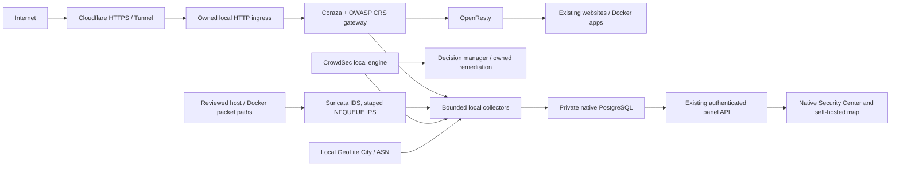

# Unified Security Center implementation

The approved design preserves OpenResty, Docker applications, Cloudflare Tunnel,
SSH and WireGuard. Existing enforcement remains active while replacements are
qualified. All administration stays inside CyberPross Panel.

## Architecture

## Delivery stages

1. Snapshot topology and firewall ownership; import GeoIP credentials privately.
2. Create native private event database, normalized bounded ingestion, redaction,
   deduplication, retention, investigation APIs and health reporting.
3. Build pinned native Coraza gateway on an unused loopback port. Validate CRS,
   four exploit samples, benign responses and per-domain policies. Do not change
   live routing until comparison evidence passes.
4. Integrate CrowdSec's actual local API without duplicating a running engine.
   Because the discovered engine is embedded in BunkerWeb, preserve its state and
   plan a standalone native replacement before BunkerWeb retirement.
5. Native panel views: overview, map, traffic, event explorer, investigations,
   enforcement, rules, Docker coverage and settings; automatic updates.
6. Validate NFQUEUE/drop behaviour in an isolated network namespace, then enable
   only reviewed traffic classes with independent rollback and management
   exemptions. Never globally convert ET Open alerts to drop rules.
7. Compare each production route, migrate gradually, and request explicit approval
   before retiring BunkerWeb. Backup and rollback remain available.

## Initial operating limits

Keep the current availability-first behaviour during qualification: a missing
inspection engine must not strand management access. Inspection gaps are visible.
Proposed defaults are 30 days of security events and 24 hours of flow/DNS metadata,
a bounded ingestion queue and bounded batches, no request bodies/authentication
headers or packet capture. Flow detail collection is enabled only after its
storage and redaction path has been qualified. Metrics must distinguish actual
inspection and enforcement from requested policy, alerts, or inferred coverage.

Each stage records test evidence. Features not yet deployed/verified remain marked
as such. Engine installation does not establish production qualification or prove
that every vulnerability is mitigated.

## Current qualification evidence

Native Coraza and its Caddy connector are version-pinned and source-built with an
official checksum-pinned Go compiler. `scripts/build-coraza.py` repeats the build;
`scripts/coraza-privacy-patch.py` changes connector logging only. It replaces
matched-value messages with structured signature metadata and adds actual
interruption action/status fields. Core enforcement code and CRS stay upstream.
Private GeoIP and database credentials are runtime-only and never packaged.

The current milestone has verified real PostgreSQL ingestion/deduplication,
redaction and investigation persistence; local public-IP City/ASN lookup with
private-IP exclusion; existing CrowdSec local API access; default and per-domain
Coraza Block/Monitor/Off enforcement; four signature categories; and actual
Suricata NFQUEUE benign/drop/fail-open behaviour in an isolated namespace.
Functional UI checks covered light/black-dark overview, event tables, incident
view and a country-map fallback. The automation browser lacks WebGL2, so GPU
MapLibre rendering is not claimed verified there. Vector tile generation and
local serving are tested separately.

Still pending before the complete production replacement: reviewed native
CrowdSec state migration, original visitor identity qualification, route-by-route
Coraza cutover, live IPS traffic-class policies and independent watchdog/rollback,
representative load qualification, separate least-privilege collectors, permanent
ban/allowlist reconciliation, complete scheduled rule/scenario deployment and
backup/restore drills. The presence of a page or an installed engine does not
mean these remaining functions are complete. BunkerWeb retirement requires its
own explicit approval after the replacement and CrowdSec migration are ready.
